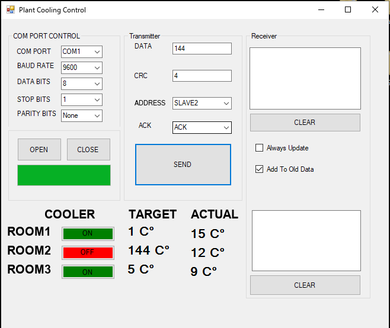

# Plant Cooling System: Temperature Control with a C# GUI

[Türkçe](README.tr.md)

A temperature control system for the rooms of a cooling plant. Four PIC16F877A microcontrollers (one master, three slaves) talk over an RS-485 bus, and a C# desktop GUI sets the target temperature for each room and shows the measured values.



## Overview

| | |
|---|---|
| Microcontrollers | 4 × PIC16F877A (1 master, 3 slaves) |
| Sensor | LM35 on each slave (−55 °C to +150 °C) |
| Display | BCD 7-segment display on each slave (temperature and CRC) |
| MCU ↔ MCU link | RS-485 half duplex, MAX487 transceivers |
| GUI ↔ master link | Full duplex, two MAX487 in parallel |
| Firmware | C, CCS C compiler |
| GUI | C# WinForms (.NET Framework) |
| Simulation | Proteus, with virtual COM ports from VSPE |

## How it works

### Packet format

Every message is a 6-byte packet:

| Byte | Field |
|---|---|
| 1 | Sender address |
| 2 | Receiver address |
| 3 | ACK |
| 4 | Data length |
| 5 | Data |
| 6 | CRC |

The receiver checks the CRC before it uses the data, so a corrupted packet is dropped instead of acted on.

### Master

- Receives the target temperature for each room from the GUI.
- Handles incoming bytes in the RDA (UART receive) interrupt.
- Builds packets for the slaves with `make_packet` and forwards them.
- Lights an LED when a slave acknowledges a packet.

### Slaves

- Read the room temperature from the LM35.
- Compare it with the target from the master and switch the cooler on or off.
- Show the temperature and the CRC on the BCD display.
- Send the measured temperature back to the GUI with `send_gui`.
- Light an error LED when a packet fails its check.

### GUI

- **COM port settings**: port, baud rate, parity and data bits.
- **Transmitter**: sends target temperatures and ACKs.
- **Receiver**: shows the raw incoming data, for testing.
- **System view**: room temperatures and the state of each cooler.

## Repository layout

```
Circuit/Devre Şeması.pdsprj          Proteus schematic and simulation
Embedded Code Master and Slave/code/ CCS C firmware (CRC_MASTER.c, CRC_SLAVE_*.c) and .hex files
Form1.cs, Form1.Designer.cs          C# GUI
*.sln, GUI.csproj                    Visual Studio solution
```

`CRC_SLAVE_3` is included as a `.hex` file only.

## Running it

1. Open `Circuit/Devre Şeması.pdsprj` in Proteus. The `.hex` files are already built. To rebuild them, compile the `.c` files with CCS C.
2. Create a pair of virtual COM ports with VSPE and connect one of them to the virtual serial port in the Proteus schematic.
3. Open the `.sln` in Visual Studio and run the GUI.
4. In the GUI, choose the other COM port, set 9600 baud, no parity, 8 data bits, 1 stop bit (the firmware settings) and connect.
5. Enter a target temperature for a room and send it. The slave's display and the GUI's system view should update.

## Licence

MIT, see [LICENSE.txt](LICENSE.txt).
